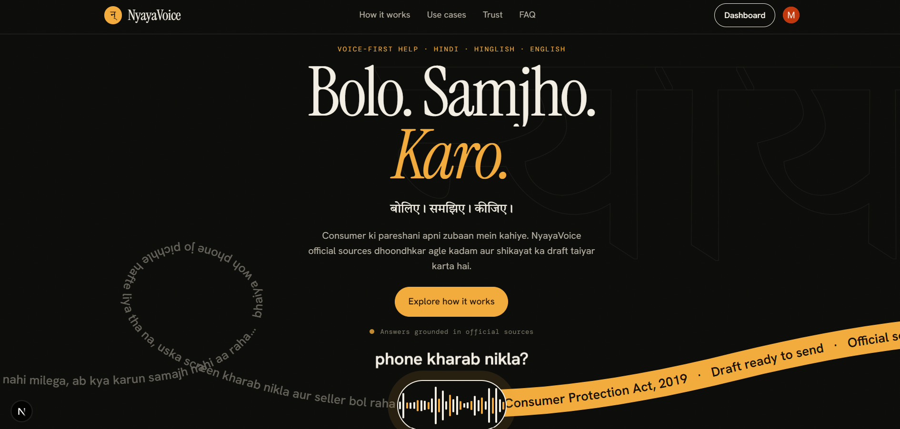
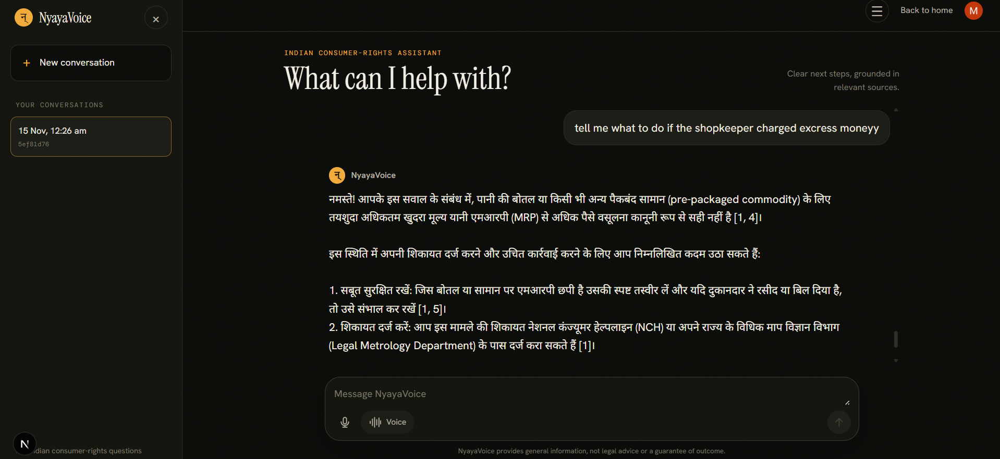
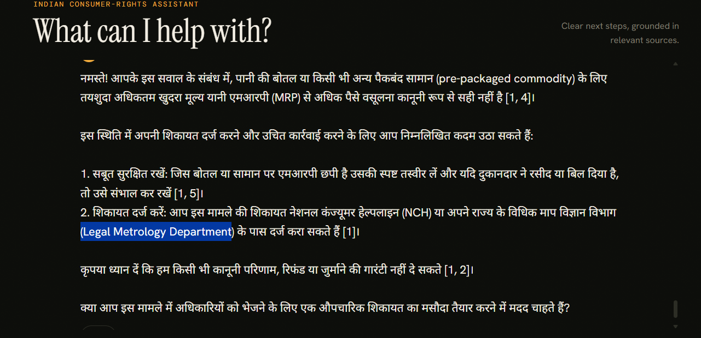
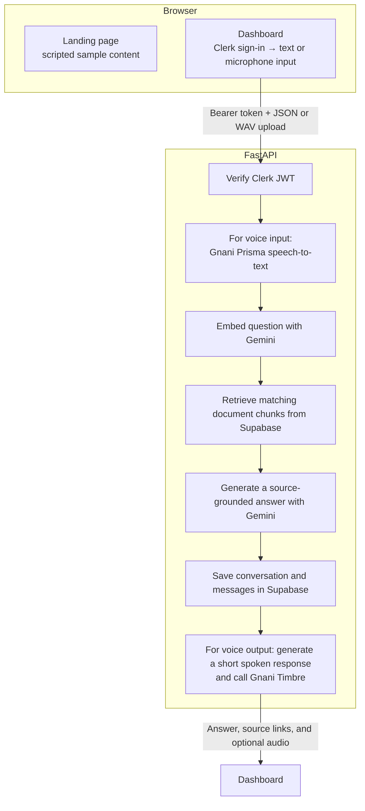

<!-- Add your hero artwork at docs/hero-banner.png. -->


# NyayaVoice

### “Bolo. Samjho. Apne consumer rights jaano.”

**Voice-first consumer-rights support for India.**

Ask in Hindi, Hinglish, or English to get practical next steps, relevant sources, an evidence checklist, and help drafting a complaint.

[](https://nextjs.org/)
[](https://react.dev/)
[](https://www.typescriptlang.org/)
[](https://fastapi.tiangolo.com/)
[](https://ai.google.dev/)
[](https://supabase.com/)
[](https://clerk.com/)
[](https://www.gnani.ai/)

[Get Started](#run-locally) · [System Architecture](#system-architecture) · [Demo Video](#demo-video) · [API Reference](#api-reference) . [Detailed 1-Page Documentation](https://drive.google.com/drive/folders/1UIzuKL8qQ7-mN7bWxTBMg-bo_ODrxRD-)

---

> NyayaVoice provides general information, not legal advice. It cannot guarantee an outcome or submit a complaint on your behalf. Check the linked official sources and verify important legal information before acting.

## What it does

- Answers consumer-rights questions in a text chat, with links to retrieved sources.
- Accepts microphone recordings for speech-to-text questions and voice conversations.
- Keeps signed-in conversations available in the dashboard.
- Can read answers aloud and return voice responses.
- Includes a scripted landing-page demo with sample content.

### The demo and the dashboard are different

The landing-page demo is a frontend-only animation using sample data in `client/lib/data.ts`. It does not record audio or call the backend. The authenticated dashboard at `/dashboard` is the real application flow: it records audio in the browser and sends the request to the API.

## Key features

| # | Feature | What it does |
| --- | --- | --- |
| 01 | Multilingual voice input | Records a spoken consumer-rights question in the dashboard and uploads it as WAV audio for transcription. The voice workflow is designed for Hindi, Hinglish, and English. |
| 02 | Gnani Prisma STT integration | The backend calls Gnani's speech-to-text API using **Prisma v3.0** (`prisma-v3.0`) with `indic-auto` language selection. The resulting transcript and detected language are passed into the assistant flow. |
| 03 | Source-grounded answers | Gemini Embedding 2 creates a query embedding; Supabase retrieves relevant knowledge chunks; Gemini 3.5 Flash Lite generates an answer using those sources and recent conversation history. |
| 04 | Gnani Timbre voice guidance | In voice-conversation mode, Gemini prepares a shorter spoken version of the answer and Gnani's text-to-speech API generates audio using **Timbre v3.0** (`timbre-v3.0`, `Shivani` voice). The API returns mono WAV audio at 48 kHz. |
| 05 | Listen to answers | The dashboard can request a spoken version of an existing text answer through the authenticated text-to-speech endpoint. |
| 06 | Conversation history | Clerk authenticates users; conversations and messages are stored in Supabase so users can continue earlier chats. |
| 07 | Scripted landing-page demo | Shows an animated sample interaction using preset content. It does not record audio or call Gnani, Gemini, or the backend. |

### Voice request flow

```text
Microphone → WAV upload → FastAPI → Gnani Prisma STT
                                   ↓ transcript + detected language
                       Gemini embedding → Supabase retrieval
                                   ↓ relevant source chunks
                       Gemini answer → answer + source links
                                   ↓ voice mode only
                       Gemini speech text → Gnani Timbre TTS → WAV playback
```

**Gnani's role:** Prisma converts the user's speech to text, and Timbre converts generated spoken guidance to audio. Gemini handles the knowledge-grounded answer and its speech-friendly rewrite; Supabase stores conversation history and provides retrieved knowledge. Gnani credentials are used by the backend and should never be placed in frontend code.

The integration is implemented in [`server/app/services/gnani/stt.py`](server/app/services/gnani/stt.py) and [`server/app/services/gnani/tts.py`](server/app/services/gnani/tts.py). The STT request uses `https://api.vachana.ai/stt/v3` with `model=prisma-v3.0` and `language_code=indic-auto`. The TTS request uses `https://api.vachana.ai/api/v1/tts/inference` with `model=timbre-v3.0`; voice conversations request mono WAV audio at 48 kHz.

## Screenshots

Add screenshots at the paths below:

### Landing page



### Dashboard chat



### Voice conversation


### Answer and sources



## System architecture



```text
Browser
  ├─ Landing page: scripted sample content
  └─ Dashboard: Clerk sign-in → text or microphone input
       │ Bearer token + JSON or WAV upload
       ▼
FastAPI
  ├─ Verify Clerk JWT
  ├─ For voice input: Gnani Prisma speech-to-text
  ├─ Embed question with Gemini
  ├─ Retrieve matching document chunks from Supabase
  ├─ Generate a source-grounded answer with Gemini
  ├─ Save conversation and messages in Supabase
  └─ For voice output: generate a short spoken response and call Gnani Timbre
       │ Answer, source links, and optional audio
       ▼
Dashboard
```

For chat, the backend loads recent conversation history, retrieves up to five relevant knowledge chunks, and sends the question and retrieved context to Gemini. Source details are returned with the answer. Voice input first goes through speech recognition; voice conversations also generate and return WAV audio.

## Demo video

Add a link to the NyayaVoice demo video here.

## Technology

| Area | Technologies |
| --- | --- |
| Frontend | Next.js 15 App Router, React 19, TypeScript |
| Authentication | Clerk (`@clerk/nextjs`) |
| Backend API | Python, FastAPI, Uvicorn |
| Language model | Google Gemini (`gemini-3.5-flash-lite`) |
| Embeddings | Google Gemini (`gemini-embedding-2`, 768 dimensions) |
| Retrieval and persistence | Supabase, with a `match_document_chunks` RPC |
| Speech | Gnani Prisma v3.0 STT and Timbre v3.0 TTS |

## Repository layout

```text
client/
  app/                    Next.js routes, metadata, styles, SEO
  components/             Landing page and dashboard UI
  components/dashboard/ Chat, voice recorder, conversation history
  lib/api.ts              Authenticated API client and response types
  lib/data.ts             Landing-page demo, FAQ, links, and sample content
server/
  app/api/v1/              FastAPI routes
  app/core/                Settings, Supabase client, Clerk JWT verification
  app/services/            Chat, conversation, RAG, Gemini, and Gnani integrations
  data/knowledge/           Local Markdown knowledge source
  scripts/                 Knowledge ingestion utility
  tests/                   Manual integration/smoke scripts
docs/                      README hero image and project screenshots
```

## Run locally

### Prerequisites

- Node.js 20 or newer and npm.
- Python 3.10 or newer.
- Clerk, Google Gemini, Gnani, and Supabase projects/credentials for the live dashboard and API.

### 1. Configure the frontend

Create `client/.env.local` (you can start from `client/.env.example`) and set:

```dotenv
NEXT_PUBLIC_API_URL=http://127.0.0.1:8000
NEXT_PUBLIC_SITE_URL=http://localhost:3000
NEXT_PUBLIC_CLERK_PUBLISHABLE_KEY=
CLERK_SECRET_KEY=
```

Set the Clerk values from your Clerk project. Never commit secret keys. `NEXT_PUBLIC_API_URL` is the FastAPI origin only; do not append `/api/v1`.

Install dependencies and start Next.js:

```bash
cd client
npm install
npm run dev
```

Open [http://localhost:3000](http://localhost:3000). The marketing page and scripted demo can render without the backend, but signing in and using the dashboard requires the services below.

### 2. Configure and run the backend

Create `server/.env` with these settings:

```dotenv
GNANI_API_KEY_ID=
GEMINI_API_KEY=
SUPABASE_URL=
SUPABASE_SERVICE_ROLE_KEY=
CLERK_FRONTEND_API_URL=
```

`CLERK_FRONTEND_API_URL` must be the issuer/domain for the same Clerk instance used by the frontend. Keep all credentials server-side; especially never expose the Supabase service-role key in a `NEXT_PUBLIC_*` variable.

Install and launch the API from the `server` directory so its `.env` is loaded:

```bash
cd server
python -m venv .venv
# Windows PowerShell:
.venv\Scripts\Activate.ps1
# macOS/Linux:
# source .venv/bin/activate
pip install -r requirements.txt
uvicorn app.main:app --reload --host 127.0.0.1 --port 8000
```

The API health check is at [http://127.0.0.1:8000/api/v1/health](http://127.0.0.1:8000/api/v1/health); interactive API docs are at `/docs`.

### 3. Configure Supabase

The backend expects the following database objects:

- `conversations` and `messages` for per-user chat history.
- `sources` and `document_chunks` for the knowledge base.
- A `match_document_chunks` RPC accepting `query_embedding`, `match_threshold`, and `match_count`, and returning matching chunk content, metadata, source IDs, and similarity.

The repository does not include SQL migrations for these objects. Set up the schema, vector extension/function, and row-level access policies in your Supabase project before using the live API. The backend uses the service-role key, so keep it private and use the application's user-ownership checks for conversation access.

## Environment variables

| Variable | Used by | Purpose |
| --- | --- | --- |
| `NEXT_PUBLIC_API_URL` | Frontend | FastAPI origin, without `/api/v1` |
| `NEXT_PUBLIC_SITE_URL` | Frontend | Canonical URL, sitemap, robots, and social metadata |
| `NEXT_PUBLIC_CLERK_PUBLISHABLE_KEY` | Frontend | Clerk browser configuration |
| `CLERK_SECRET_KEY` | Frontend/server runtime | Clerk server-side configuration |
| `CLERK_FRONTEND_API_URL` | Backend | Clerk JWT issuer and JWKS host |
| `GNANI_API_KEY_ID` | Backend | Gnani speech API credential |
| `GEMINI_API_KEY` | Backend | Gemini generation and embeddings |
| `SUPABASE_URL` | Backend | Supabase project URL |
| `SUPABASE_SERVICE_ROLE_KEY` | Backend | Server-only Supabase access |

Use environment variables in your hosting provider for deployment. Do not commit `.env` files, screenshots containing secrets, or real user recordings.

## API Reference

The local API base URL is `http://127.0.0.1:8000`; versioned routes use the `/api/v1` prefix. For example, the chat endpoint is `http://127.0.0.1:8000/api/v1/chat`. The frontend's `NEXT_PUBLIC_API_URL` should contain only the server origin, not `/api/v1`.

FastAPI's interactive reference is available at `http://127.0.0.1:8000/docs` while the backend is running.

### Authentication

Send a Clerk session token with every application request except `GET /` and `GET /api/v1/health`:

```http
Authorization: Bearer <clerk-session-token>
```

Conversation IDs are scoped to the signed-in user. Supplying another user's conversation ID will not grant access to it.

### Endpoint summary

| Method | Path | Authentication | What it does |
| --- | --- | --- | --- |
| `GET` | `/` | No | Backend welcome and status |
| `GET` | `/api/v1/health` | No | Backend health check |
| `GET` | `/api/v1/health/protected` | Yes | Verifies the session token |
| `POST` | `/api/v1/chat` | Yes | RAG-backed text conversation |
| `GET` | `/api/v1/conversations/` | Yes | Lists the user's conversations |
| `GET` | `/api/v1/conversations/{conversation_id}/messages` | Yes | Loads messages from an owned conversation |
| `POST` | `/api/v1/voice/stt` | Yes | Transcribes uploaded audio |
| `POST` | `/api/v1/voice/ask` | Yes | Transcribes audio, then returns a text answer |
| `POST` | `/api/v1/voice/conversation` | Yes | Transcribes audio and returns a text and spoken answer |
| `POST` | `/api/v1/voice/tts` | Yes | Converts text into a WAV audio response |

### `GET /` and `GET /api/v1/health`

Use these unauthenticated routes to check that the backend is reachable.

`GET /` returns:

```json
{ "message": "Welcome to NyayaVoice Backend", "status": "running" }
```

`GET /api/v1/health` returns:

```json
{ "status": "healthy", "service": "NyayaVoice Backend" }
```

### `GET /api/v1/health/protected`

Requires a valid Clerk token. Useful for checking that the backend can verify the current session.

```json
{
  "status": "authenticated",
  "user_id": "<clerk-user-id>",
  "session_id": "<clerk-session-id>"
}
```

### `POST /api/v1/chat`

Send JSON containing a non-empty `message`. Include `conversation_id` to continue an existing conversation; omit it to create a new one. The backend loads recent history, retrieves relevant knowledge-base chunks, generates an answer with Gemini, and stores the user and assistant messages.

```json
{
  "message": "A seller refused my refund. What can I do?",
  "conversation_id": "<optional-conversation-uuid>"
}
```

Response:

```json
{
  "conversation_id": "<conversation-uuid>",
  "response": "<source-grounded answer>",
  "speech_response": null,
  "sources": [
    {
      "title": "<source title>",
      "url": "<source URL>",
      "authority": "<source authority>",
      "verification_status": "<source status>",
      "chunk_refs": [1]
    }
  ]
}
```

The `sources` array may be empty when retrieval finds no sufficiently relevant information. A blank message returns `400`; an invalid conversation ID returns `400`.

### `GET /api/v1/conversations/`

Lists conversations belonging to the authenticated user, most recently active first.

```json
{
  "conversations": [
    {
      "id": "<conversation-uuid>",
      "created_at": "<timestamp>",
      "updated_at": "<timestamp>"
    }
  ]
}
```

### `GET /api/v1/conversations/{conversation_id}/messages`

Returns up to 100 messages from the specified conversation, in chronological order. The conversation must belong to the authenticated user.

```json
{
  "conversation_id": "<conversation-uuid>",
  "messages": [
    {
      "id": "<message-id>",
      "role": "user",
      "content": "<message text>",
      "created_at": "<timestamp>"
    }
  ]
}
```

Returns `404` when the conversation does not exist or is not owned by the current user.

### `POST /api/v1/voice/stt`

Send `multipart/form-data` with an `audio` file whose content type starts with `audio/`. This route sends the recording to Gnani Prisma and returns the transcription provider's JSON response. It does not create a chat response.

The dashboard recorder currently sends WAV audio. An unsupported or empty upload returns `400`; a Gnani service or connection failure returns `502`.

### `POST /api/v1/voice/ask`

Send `multipart/form-data` containing:

| Field | Required | Description |
| --- | --- | --- |
| `audio` | Yes | Audio recording (`audio/*`) |
| `conversation_id` | No | Existing conversation UUID to continue |

The backend transcribes the audio, uses the transcript as the chat message, saves the conversation, and returns a text answer with source references.

```json
{
  "conversation_id": "<conversation-uuid>",
  "transcript": "<recognized speech>",
  "detected_language_code": "hi-IN",
  "response": "<source-grounded answer>",
  "sources": []
}
```

### `POST /api/v1/voice/conversation`

Uses the same multipart fields and processing as `/voice/ask`, then generates spoken guidance using Gnani Timbre. The JSON response includes the transcript, answer, source references, and base64-encoded WAV audio:

```json
{
  "conversation_id": "<conversation-uuid>",
  "transcript": "<recognized speech>",
  "detected_language_code": "hi-IN",
  "response": "<source-grounded answer>",
  "sources": [],
  "audio_format": "wav",
  "audio_base64": "<base64-encoded-audio>"
}
```

### `POST /api/v1/voice/tts`

Send JSON with the text to speak. `voice` and `language` are optional; they default to `Shivani` and `hi-IN`.

```json
{
  "text": "Keep your receipt and contact the seller in writing.",
  "voice": "Shivani",
  "language": "hi-IN"
}
```

Returns WAV audio bytes (`Content-Type: audio/wav`), not JSON. Empty text returns `400`; a Gnani service or connection failure returns `502`.

### Common errors

| Status | Meaning |
| --- | --- |
| `400` | Empty message, audio, or text; non-audio upload; or invalid conversation ID |
| `401` | Missing, invalid, expired, or wrong-origin Clerk token |
| `404` | Conversation not found or not owned by the signed-in user |
| `422` | Required request field is missing or fails FastAPI validation |
| `500` | Voice conversation failed unexpectedly |
| `502` | AI, speech provider, or upstream request failed |

## Knowledge base

The checked-in ingestion utility is `server/scripts/ingest_markdown.py`. It chunks `server/data/knowledge/offline_pricing_mrp.md`, creates Gemini embeddings, and upserts them into Supabase. Before running it, configure the backend environment, ensure the matching source record exists (the script currently uses source ID `7`), and review the destination schema.

The checked-in MRP document is explicitly marked **research draft** and calls for primary-source verification. The live retrieval results also depend on what has been ingested into your Supabase project. Review and verify legal material before using it for production answers.

## Development checks

Frontend:

```bash
cd client
npm run typecheck
npm run build
```

Backend smoke scripts in `server/tests/` call external services and Supabase; they are not isolated unit tests. Run them only after configuring valid credentials and data, with the `server` directory on `PYTHONPATH`:

```bash
PYTHONPATH=. python tests/test_rag.py
PYTHONPATH=. python tests/test_retrieval.py
```

In Windows PowerShell, set `$env:PYTHONPATH = (Get-Location).Path` from `server` before running the same `python tests/...` commands.

## Security, privacy, and limitations

- Clerk protects the dashboard. The API verifies bearer tokens using Clerk's JWKS and checks conversation ownership before reading or writing messages.
- Microphone audio is captured in the browser, uploaded to the backend, and sent to Gnani for transcription. The code does not save uploaded audio to the project database; chat text and assistant responses are persisted in Supabase.
- Gemini answers depend on the retrieved material and can be incomplete or incorrect. A source link is not a substitute for checking the source itself.
- This is not a law firm, legal representative, complaint-filing service, or guarantee of a legal result. Users decide whether to contact a seller, helpline, regulator, or lawyer.
- Browser recordings require microphone permission and a secure context in deployed environments.
- The current backend CORS allowlist and Clerk token `azp` check are hard-coded for `http://localhost:3000` in `server/app/main.py` and `server/app/core/security.py`. Update both to the exact deployed frontend origin before deployment; also configure the Clerk instance for that origin.
- Do not use the project with sensitive personal data until the deployment, provider data handling, database access policies, and privacy notices have been reviewed.

## Deployment

The frontend and API are separate applications:

1. Deploy `client/` to a Next.js host such as Vercel and set the frontend environment variables there.
2. Deploy `server/` to a Python host with a start command such as `uvicorn app.main:app --host 0.0.0.0 --port $PORT`.
3. Configure the backend environment variables and Supabase schema/knowledge base.
4. Set `NEXT_PUBLIC_API_URL` to the backend origin and `NEXT_PUBLIC_SITE_URL` to the public frontend URL.
5. Update the backend CORS and Clerk allowed-origin checks to match the deployed frontend URL, then verify the health check and authenticated chat/voice flows.

Fonts use `next/font/google`, so the frontend build must be able to fetch the font files.

## Author

- Name: Mehul Kumar Singh
- GitHub: [https://github.com/Mehhhhull](https://github.com/Mehhhhull)
- LinkedIn: [[Your LinkedIn profile]](https://www.linkedin.com/in/mehul-kumar-singh-655b5432b)
- Email: mehulkumarsingh.2004@gmail.com
